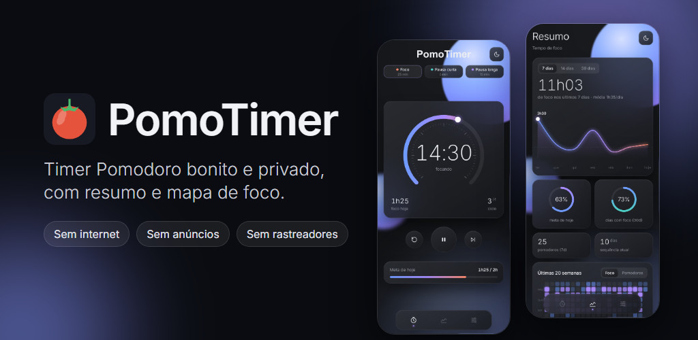
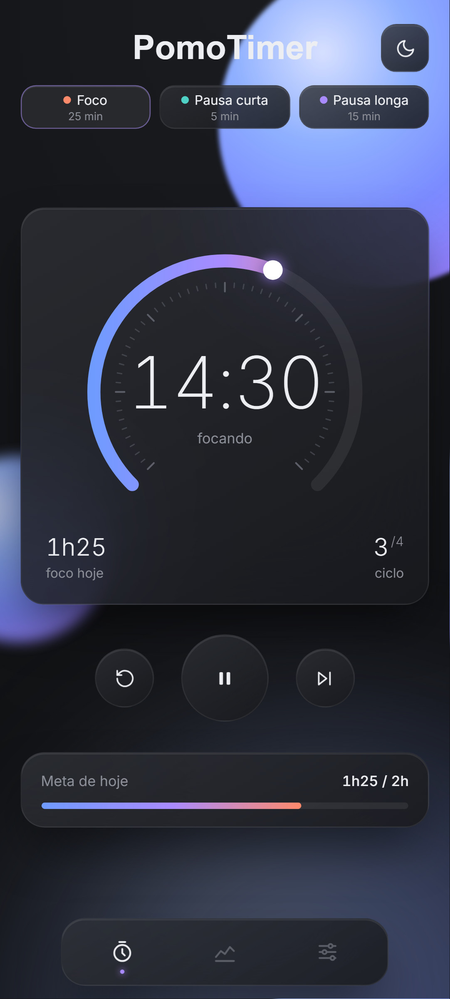
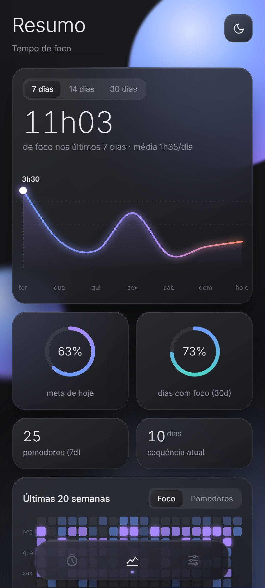
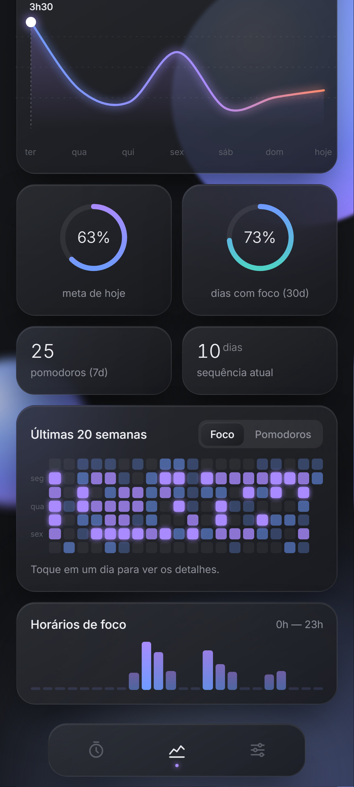
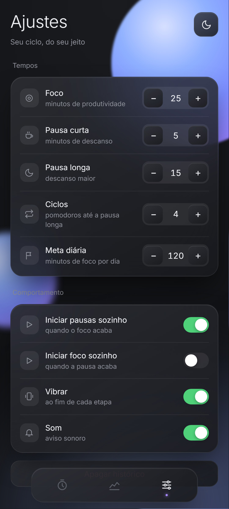
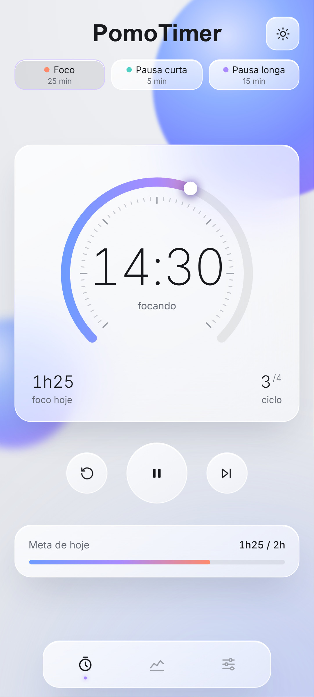
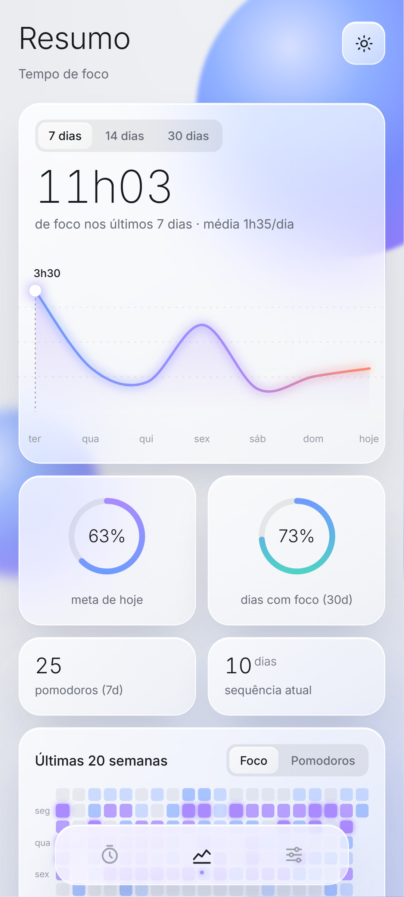

<p align="center">
  
</p>

<p align="center">
  <a href="https://github.com/0onzelobo/PomoTimer/releases/latest"></a>
  <a href="https://github.com/0onzelobo/PomoTimer/actions/workflows/build.yml"></a>
  
  <a href="LICENSE"></a>
</p>

# PomoTimer

Timer Pomodoro para Android, bonito e privado: vidro fosco, modo escuro e claro, medidor em arco,
resumo com gráfico, mapa de calor e horários de foco. **Sem internet, sem anúncios, sem rastreadores.**

<p align="center">
  <a href="https://github.com/0onzelobo/PomoTimer/releases/latest"><b>⬇️ Baixar o APK mais recente</b></a>
</p>

## Capturas de tela

| Timer | Resumo | Mapa de foco |
|:---:|:---:|:---:|
|  |  |  |
| **Ajustes** | **Modo claro** | **Resumo no modo claro** |
|  |  |  |

<sub>As capturas usam dados de exemplo.</sub>

## Recursos
- **Timer Pomodoro completo**: foco, pausa curta, pausa longa e número de ciclos até a pausa longa, tudo ajustável.
- **Funciona com o app fechado**: o aviso chega no horário certo com a tela desligada, com notificação,
  som e vibração (cada um pode ser desligado). A contagem regressiva aparece na barra de notificações.
- **Início automático**: as pausas, e se você quiser também o foco, começam sozinhas, mesmo com o app fechado.
- **Resiste a reinícios**: se o celular reiniciar no meio de uma etapa, o aviso é reagendado.
- **Meta diária** de minutos de foco, com barra de progresso.
- **Resumo**: gráfico de 7, 14 ou 30 dias, meta de hoje, dias com foco, pomodoros, sequência de dias,
  mapa de calor das últimas 20 semanas e os horários em que você mais foca.
- **Tema** escuro, claro ou automático (segue o sistema), com ícone temático no Android 13+.

## Privacidade
- O app **não tem permissão de internet**: não tem como enviar nada para lugar nenhum.
- Sem anúncios, analytics, rastreadores, contas ou login.
- O histórico fica só no aparelho. Apagar o histórico em **Ajustes** ou desinstalar o app remove tudo.

Detalhes e lista de permissões em [`PRIVACY.md`](PRIVACY.md).

## Instalar
1. Baixe o `pomotimer-X.Y.Z.apk` em [**Releases**](https://github.com/0onzelobo/PomoTimer/releases/latest).
2. Abra o arquivo no celular e permita instalar apps desta fonte quando o Android pedir.
3. Na primeira vez que iniciar o timer, o app pede permissão de **notificações** e de **alarme exato**.
   As duas são opcionais, mas sem elas o aviso com o app fechado pode não chegar ou chegar atrasado.

Atualizações instalam por cima da versão anterior, sem perder o histórico.

### Conferir se o APK é oficial
Todo APK oficial é assinado com o certificado abaixo (`CN=PomoTimer`). A Release também traz o
checksum SHA-256 do arquivo. Como conferir: [`SECURITY.md`](SECURITY.md).
```
CE:5A:10:F0:88:C8:AA:BF:69:21:27:4C:0C:40:EF:67:D0:0E:B3:60:56:18:6D:5D:DA:A4:92:3B:DB:3A:E8:A5
```

## Compilar
- **Requisitos**: JDK 17 e Android SDK 36. O app é compatível com Android 8.0 (API 26) ou superior.
- **Android Studio**: abra a pasta do projeto e escolha *Build › Build APK(s)*.
- **Terminal**:
  ```powershell
  .\gradlew.bat lintDebug assembleDebug --no-daemon
  ```
  O APK de teste será gerado em `app/build/outputs/apk/debug/app-debug.apk`.

### Compilação automática (GitHub Actions)
- **A cada envio para a `main`**: roda o lint e compila um APK de teste, disponível em
  *Actions › execução › Artifacts*. Ele é assinado com uma chave de debug temporária, então para
  instalar por cima de outro build é preciso desinstalar o anterior.
- **Nova versão**: crie e envie uma tag `vX.Y.Z`. O workflow *Release* compila o APK assinado e
  publica em **Releases** com o checksum SHA-256 e a impressão digital do certificado.
  ```powershell
  git tag v1.2.0
  git push origin v1.2.0
  ```
  O `versionCode` sai da tag (`1.2.3` → `10203`), então cada versão nova precisa de um número maior.
  Os secrets `KEYSTORE_BASE64`, `KEYSTORE_PASSWORD`, `KEY_ALIAS` e `KEY_PASSWORD` precisam estar em
  *Settings › Secrets and variables › Actions*.

### Release assinado local
Configure localmente `KEYSTORE_FILE`, `KEYSTORE_PASSWORD`, `KEY_ALIAS` e `KEY_PASSWORD`, depois execute
`.\gradlew.bat assembleRelease --no-daemon`. A keystore **nunca** deve ir para o repositório (`.gitignore`
bloqueia `*.jks` e `*.keystore`).

## Estrutura
- `app/src/main/assets/index.html` — interface completa (HTML/CSS/JS, sem rede, CSP estrita)
- `MainActivity.kt` — WebView endurecido + ponte `window.Android` com entrada validada
- `Alarms.kt` — AlarmManager (exato quando permitido), notificações e emenda das etapas em segundo plano
- `BootReceiver.kt` — reagenda a etapa em andamento depois que o aparelho reinicia
- `fastlane/metadata/android/` — descrição, notas de versão, ícone e capturas (formato do F-Droid)

## Contribuir
Achou um bug ou tem uma ideia? Abra uma [issue](https://github.com/0onzelobo/PomoTimer/issues).
Vulnerabilidades de segurança: siga o [`SECURITY.md`](SECURITY.md), sem issue pública.

## Licença
Código sob licença [MIT](LICENSE). A fonte Inter, embutida no app, é distribuída sob a SIL Open Font
License 1.1 (`app/src/main/assets/licenses/OFL-Inter.txt`).
